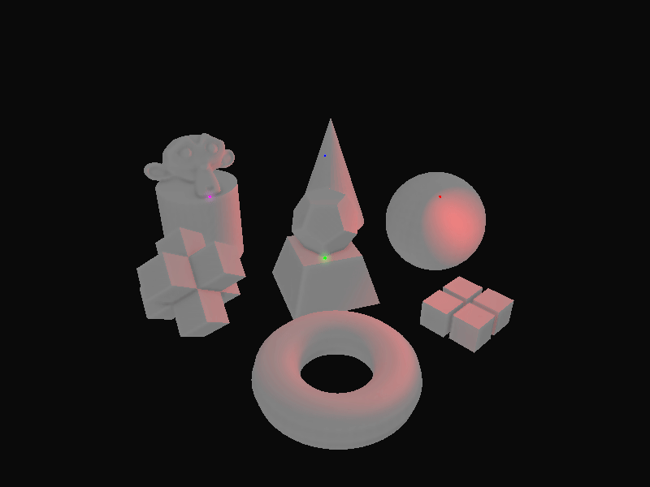
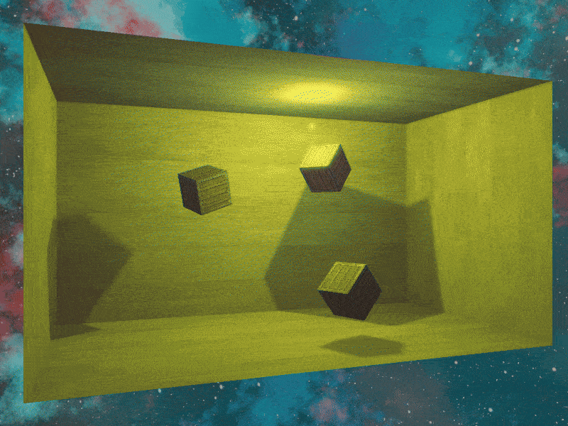
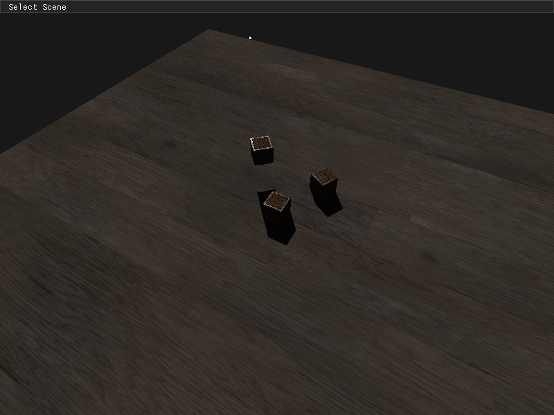

<h1 align="center">
    OpenGL Renderer
</h1>

<p align="center">
    A study project to learn computer graphics and software design principles/patterns through the OpenGL API.
</p>

<p align="center">
    
    
    
    
    
    
</p>

<p align="center">
    
    <br>
    <sub><i>0.96.0 Screen space ambient occlusion</i></sub>
</p>

------------------------------------------------------------------------------------------

## Folders

```bash
study-opengl/
├── _display/                   # Screenshots and GIFs of each rendering milestone
├── config/                     # config.yaml: window, camera and scene settings
├── data/                       # Models, textures, cubemaps and scene definitions
│   ├── _predefs/               # Predefined materials and objects
│   └── _scenes/                # One test scene per chapter (e.g. 4.3_shadows_testscene.cpp)
├── libs/                       # Bundled third-party libraries (GLAD, ImGui, stb)
├── scripts/                    # Python helpers: naming convention checks, bulk renaming
│   └── legacy/                 # Old CMake / Visual Studio .bat scripts, kept for reference; see legacy/README.md
├── shaders/                    # GLSL shaders, named <chapter>-<name>-<vrtx|frag|geom>.glsl
├── source/                     # Renderer source code (core, scene, events, utils, tests)
├── xmake.lua                   # Build script (xmake), incl. the binaries and pack tasks
└── CMakeLists.txt              # Legacy CMake / Visual Studio build, being phased out
```

------------------------------------------------------------------------------------------

## Installation and Usage

### Prerequisites
- **Windows 10/11** with an OpenGL 3.3 capable graphics driver
- **Git**: [Install Git](https://git-scm.com/downloads)
- **MSYS2**: [Install MSYS2](https://www.msys2.org/)
- No Visual Studio or Windows SDK needed: Clang, the Windows headers (mingw-w64) and the C++ runtime all come from MSYS2.

Install the tools in the **MSYS2 CLANG64** shell:

```bash
# Clang with the lld linker and lldb debugger, and xmake
pacman -S --needed mingw-w64-clang-x86_64-clang mingw-w64-clang-x86_64-lld mingw-w64-clang-x86_64-lldb mingw-w64-clang-x86_64-xmake

# Optional: Qt Creator, to build, run and debug from an IDE
pacman -S --needed mingw-w64-clang-x86_64-qt-creator
```

### Installation

Run these in the **MSYS2 CLANG64** shell.

```bash
# 1. Clone the repository with its submodules
git clone --recursive https://github.com/kutaycoskuner/study-opengl.git
cd study-opengl

# 2. Configure once: MinGW platform, Clang compiler, debug mode
xmake f -p mingw --toolchain=clang -m debug

# 3. Build (the first build downloads and compiles GLFW and Assimp, which takes a few minutes)
xmake -y
```

### Building

| Mode    | Use it for                                              | Output                                           |
| :------ | :------------------------------------------------------ | :----------------------------------------------- |
| debug   | Development and debugging (debug info, no optimization) | `build/mingw/x86_64/debug/opengl_renderer.exe`   |
| release | Running fast (optimized, no debug info)                 | `build/mingw/x86_64/release/opengl_renderer.exe` |

```bash
xmake f -m debug    # switch to debug mode (xmake f -m release for release)
xmake               # build the current mode
xmake binaries      # build both debug and release, then return to the current mode
xmake pack          # build release and copy a standalone program into artifacts/
xmake c             # clean the current mode's build output
```

### Running

```bash
# Current mode, in the CLANG64 shell
xmake run

# A specific build, in the CLANG64 shell
./build/mingw/x86_64/debug/opengl_renderer.exe
./build/mingw/x86_64/release/opengl_renderer.exe

# Standalone copy: double-click artifacts/opengl_renderer.exe in Explorer after
xmake pack
# the artifacts/ folder can be moved or copied to another PC
```

> The exes in `build/` need `libc++.dll` and `zlib1.dll` from MSYS2, so they only start from the CLANG64 shell
> (or an IDE started there), not by double-click. `xmake pack` copies both DLLs next to the exe in `artifacts/`.

> The program first looks for `config/config.yaml` next to the exe (packed copy, relative paths) and otherwise
> uses the repository paths compiled in by `xmake.lua`. The `failed to open file: ...config.yaml` line when
> starting a `build/` exe is that first lookup and is expected.

### Opening in an IDE

**Qt Creator** (build, run, debug). Qt Creator has no xmake support, so it opens the `compile_commands.json` that xmake writes on every build.

```bash
# 1. Build once so compile_commands.json exists, then start Qt Creator from the CLANG64 shell
#    (it inherits the CLANG64 PATH, so it finds clang, xmake, lldb and the MSYS2 DLLs)
xmake
qtcreator &

# 2. Help > About Plugins...: enable CompilationDatabaseProjectManager, restart Qt Creator

# 3. File > Open File or Project...: compile_commands.json in the repository root
#    kit: the MSYS2 CLANG64 clang kit, build directory: the repository root

# 4. Projects > Build: replace the build steps with a Custom Process Step
#    command:   C:\msys64\clang64\bin\xmake.cmd
#    arguments: -y          (clean step: c)

# 5. Projects > Run: add a Custom Executable per mode, working directory %{buildDir}
#    debug:   %{buildDir}\build\mingw\x86_64\debug\opengl_renderer.exe
#    release: %{buildDir}\build\mingw\x86_64\release\opengl_renderer.exe

# 6. Pick the run configuration at the bottom left: Ctrl+B build, Ctrl+R run, F5 debug
#    Ctrl+B builds the mode set with xmake f -m; debug with the debug build only
```

**VS Code** (editing). Use an MSYS2 CLANG64 shell as the integrated terminal and build and run there with the commands above.

```bash
# terminal profile command for the CLANG64 shell
C:\msys64\msys2_shell.cmd -defterm -here -no-start -clang64

# code completion: the clangd extension finds compile_commands.json in the repository root by itself;
# the Microsoft C/C++ extension needs the setting C_Cpp.default.compileCommands pointed at it
```

------------------------------------------------------------------------------------------

## Controls

| Key            | Function                                              |
| :------------: | :---------------------------------------------------- |
| `w` `a` `s` `d`| Move camera forward / left / backward / right         |
| `space` / `x`  | Move camera up / down                                 |
| `q` / `e`      | Rotate camera left / right                            |
| `r` / `f`      | Tilt camera up / down                                 |
| `shift`        | Increase movement speed while pressed                 |
| `z`            | Toggle mouse control for rotation (default: disabled) |
| `c`            | Reset camera position                                 |
| `g`            | Toggle user interface                                 |
| `o`            | Toggle ambient occlusion (SSAO)                       |
| `t`            | Toggle screenshot mode                                |
| `↑` / `↓`      | Change texture blend factor                           |
| `esc`          | Quit                                                  |

------------------------------------------------------------------------------------------

## Feature List

- [x] Vertex-defined shape drawing
- [x] Texture importing
- [x] 3D perspective projection (custom 4x4 matrix and 2D/3D vector library)
- [x] Moveable camera and UI movement controls
- [x] Phong and Blinn-Phong illumination
- [x] Directional, point and spot lighting
- [x] Light maps and emission maps
- [x] Model importing (.obj)
- [x] Outline shader (depth and stencil test method)
- [x] Transparency through blending
- [x] Face culling
- [x] Frame buffers
- [x] Uniform buffer objects (UBO)
- [x] Cubemapped skybox
- [x] GPU instancing
- [x] Anti-aliasing (MSAA)
- [x] UI scene changer
- [x] Automated frame-based scene testing
- [x] Shadow mapping (point light / directional light)
- [x] Normal mapping
- [x] Parallax mapping
- [x] High dynamic range lighting (HDR)
- [x] Post process effect: bloom
- [x] Deferred shading
- [x] Screen space ambient occlusion (SSAO)
- [ ] Physically based rendering (PBR)

------------------------------------------------------------------------------------------

## Display

A selection of milestones. More are in the [`_display`](_display/) folder.

<p align="center">
    
    <br>
    <sub><i>0.95.0 Deferred shading</i></sub>
</p>

<p align="center">
    
    <br>
    <sub><i>0.94.6 Dynamic point light shadows with bloom post processing</i></sub>
</p>

<p align="center">
    
    <br>
    <sub><i>0.92 Parallax occlusion mapping</i></sub>
</p>

<p align="center">
    
    <br>
    <sub><i>0.90.3 Dynamic directional light shadows (shadow mapping)</i></sub>
</p>

<p align="center">
    
    <br>
    <sub><i>0.66 GPU instancing</i></sub>
</p>

<p align="center">
    
    <br>
    <sub><i>0.48 Stencil testing and outlining per item</i></sub>
</p>

------------------------------------------------------------------------------------------

## References

- **Learning**
    - [Sanderson, Grant. "Essence of Linear Algebra". _3Blue1Brown, YouTube_. 2016.](https://www.youtube.com/watch?v=fNk_zzaMoSs&list=PLZHQObOWTQDPD3MizzM2xVFitgF8hE_ab)
    - [Gordan, Victor. "Stencil Buffer & Outlining". _YouTube_. 2021.](https://www.youtube.com/watch?v=ngF9LWWxhd0)
    - [Will, Brian. "OpenGL - Depth and Stencil Buffers". _YouTube_. 2019.](https://youtu.be/wVcWOghETFw)
    - Joey de Vries, [learnopengl.com](https://learnopengl.com)
    - Jordan Santell, [jsantell.com/3d-projection](https://jsantell.com/3d-projection/)
    - Supervision / support: Volkan Ilbeyli, [github.com/vilbeyli](https://github.com/vilbeyli)
- **Dependencies**
    - Libraries: GLFW, GLAD, Assimp (Open Asset Import Library), Dear ImGui, stb_image, stb_image_write
    - Tools: MSYS2 Clang, xmake, Qt Creator, Visual Studio Code, RenderDoc (frame debugging)
- **Data**
    - Phong predefined materials: [OpenGL/VRML Materials](http://devernay.free.fr/cours/opengl/materials.html)
    - Backpack by Berk Gedik, [Sketchfab](https://sketchfab.com/3d-models/survival-guitar-backpack-799f8c4511f84fab8c3f12887f7e6b36)
    - Kokorec by Berk Gedik, [Sketchfab](https://sketchfab.com/models/141db37d07fc4ccba84ab5f38a8181b5/embed?autostart=1&internal=1&tracking=0&ui_ar=0&ui_infos=0&ui_snapshots=1&ui_stop=0&ui_theatre=1&ui_watermark=0)
    - Lantern by Rajil Jose Macatangay, [Poly Haven](https://polyhaven.com/a/Lantern_01)
    - Suzanne by Blender, [Documentation](https://docs.blender.org/manual/en/latest/modeling/meshes/primitives.html)
    - Jupiter by murilo.kleine, [Sketchfab](https://sketchfab.com/3d-models/jupiter-free-downloadable-model-61671f29ca0a4fa39dc9653290282418)
